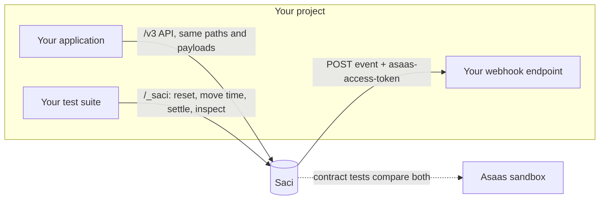

<div align="center">


# Saci

**A fake Asaas for your tests.**<br>
Pix, boleto, balances, payouts and real webhook deliveries, in a local server that behaves like the real API.

[](https://github.com/SpackiGabriel/saci/actions/workflows/ci.yml)
[](https://github.com/SpackiGabriel/saci/pkgs/container/saci)
[](pyproject.toml)
[](LICENSE)

[Português](README.md) · **English**

</div>

```bash
docker run --rm -p 8000:8000 ghcr.io/spackigabriel/saci
```

Point your integration at `http://localhost:8000` instead of `https://api-sandbox.asaas.com` and send any key in the `access_token` header. No account, no internet, any language.

Without Docker, install it straight from GitHub (Python 3.11+):

```bash
pip install git+https://github.com/SpackiGabriel/saci
saci --port 8000
```

With the server running, `http://localhost:8000/docs` lists every endpoint on an interactive page.

---

## The problem

The bugs that hurt a payment integration in production are rarely the happy path. They are the webhook that arrives twice, the endpoint that was down for an hour while events piled up, the charge that went overdue over the weekend, and the two payouts that raced for the same balance.

Those are exactly the cases you **cannot** test well today:

|  | Real sandbox | Hand-written mock | **Saci** |
| --- | :---: | :---: | :---: |
| Works offline, without an account | ✗ | ✓ | ✓ |
| Clean state for every test | ✗ (shared, never reset) | ✓ | ✓ |
| "It is now three days later" | ✗ | depends | ✓ |
| Your webhook endpoint is down: retries, ordering, queue interruption | ✗ | rarely | ✓ |
| Real balances: money in, fees, money out, overdraft refused | ✓ | rarely | ✓ |
| Deterministic ids and responses | ✗ | ✓ | ✓ |
| You can check it still matches the real API | ✓ | ✗ (drifts silently) | ✓ (contract tests) |
| Fast enough for every test run | ✗ | ✓ | ✓ |

A mock returns whatever its author remembered. Saci keeps state, moves (fake) money, delivers webhooks over HTTP, and ships a contract test suite that runs against both Saci and the Asaas sandbox. **A fake that lies is worse than no fake.**



## A 30-second tour

```bash
H='access_token: $aact_local'; API=http://localhost:8000

# A customer and a Pix charge
curl -s -X POST $API/v3/customers -H "$H" -d '{"name": "Maria Souza", "cpfCnpj": "52998224725"}'
curl -s -X POST $API/v3/payments  -H "$H" \
  -d '{"customer": "cus_000000000001", "billingType": "PIX", "value": 101.99, "dueDate": "2030-01-10"}'

# The customer pays: same sandbox action Asaas offers
curl -s -X POST $API/v3/sandbox/payment/pay_000000000001/confirm -H "$H"
curl -s $API/v3/finance/balance -H "$H"     # {"balance":100.0}   (1.99 fee deducted)

# Pay someone out over Pix
curl -s -X POST $API/v3/transfers -H "$H" \
  -d '{"value": 60, "pixAddressKey": "owner@example.com", "pixAddressKeyType": "EMAIL"}'
curl -s $API/v3/finance/balance -H "$H"     # {"balance":40.0}

# Everything that happened, in order
curl -s $API/_saci/events -H "$H"           # PAYMENT_CREATED, PAYMENT_RECEIVED, TRANSFER_CREATED, TRANSFER_DONE
```

Ids are sequential (`cus_000000000001`, `pay_000000000001`, ...). With the clock frozen, the same test against a freshly started Saci produces exactly the same responses.

## Receiving webhooks

Register your endpoint as you would on Asaas. `name`, `url`, `email` and `events` are required:

```bash
curl -s -X POST $API/v3/webhooks -H "$H" -d '{
  "name": "my-app",
  "url": "http://host.docker.internal:3000/webhooks/asaas",
  "email": "dev@example.com",
  "authToken": "local-secret-123",
  "events": ["PAYMENT_RECEIVED", "PAYMENT_OVERDUE", "TRANSFER_DONE", "TRANSFER_FAILED"]
}'
```

From then on, each subscribed event arrives as a `POST` in the documented shape, with the `authToken` in the `asaas-access-token` header:

```json
{
  "id": "evt_00000000000000000000000000000002&2",
  "event": "PAYMENT_RECEIVED",
  "dateCreated": "2026-03-02 09:00:00",
  "payment": { "object": "payment", "id": "pay_000000000001", "status": "RECEIVED", "...": "..." }
}
```

Transfer events carry `transfer` instead of `payment`. A webhook only receives events produced after it was registered. Responses never return the `authToken`; they show `hasAuthToken: true`.

If Saci runs in Docker and your application runs on the host, use `host.docker.internal` in the URL. On Linux that needs `--add-host=host.docker.internal:host-gateway` on `docker run`. Inside `docker compose`, use the service name (for example `http://app:3000/...`).

You don't need a receiver to test: `GET /_saci/events` lists every event for the account, and `GET /_saci/deliveries` shows each delivery attempt with its HTTP status and last error.

## In your tests

Saci is just an HTTP server, so your tests talk to it over the network. A pattern that works well: before each test, wipe the state and freeze the clock.

```python
@pytest.fixture
def asaas():
    with httpx.Client(base_url="http://localhost:8000", headers={"access_token": "$aact_test"}) as client:
        client.post("/_saci/reset")
        client.post("/_saci/clock", json={"now": "2026-03-02T09:00:00"})
        yield client
```

Complete examples:

- **Python / pytest**: [`examples/python-pytest`](examples/python-pytest/test_billing_flow.py)
- **Node.js**: [`examples/node/payout.mjs`](examples/node/payout.mjs), with nothing but the built-in `fetch`
- **Docker Compose**: [`examples/docker-compose.yml`](examples/docker-compose.yml), with your application next to Saci

The Python and Node ones run in CI on every pull request, against a real server.

In GitHub Actions, run it as a service container:

```yaml
jobs:
  test:
    runs-on: ubuntu-latest
    services:
      asaas:
        image: ghcr.io/spackigabriel/saci
        ports: ["8000:8000"]
    steps:
      - uses: actions/checkout@v5
      - run: pytest
        env:
          ASAAS_BASE_URL: http://localhost:8000
```

To keep state across restarts, mount a volume and point the database at it:

```bash
docker run --rm -p 8000:8000 -v saci-data:/data \
  -e SACI_DATABASE=/data/saci.db ghcr.io/spackigabriel/saci
```

Images are built for `linux/amd64` and `linux/arm64`. Tags: `latest`, `X.Y.Z` and `X.Y` on each release, `edge` for the current `main`, and `sha-<commit>` for every build.

## Recipes for the bugs that matter

**Your receiver must survive duplicate deliveries.** Delivery is at-least-once, and a retried event keeps its `id`. To control each attempt, start Saci with `SACI_DELIVERY_MODE=manual`: nothing is delivered until you call `/_saci/webhooks/deliver`.

```python
# your endpoint answers 500 on the first call, 200 afterwards
asaas.post("/_saci/webhooks/deliver")   # attempt 1 fails
asaas.post("/_saci/webhooks/deliver")   # attempt 2, same event id
assert payments_processed == 1
```

**Your endpoint was down.** After 15 consecutive failures the webhook is marked `interrupted` and the queue stops, as the Asaas documentation describes. New events keep queuing. Set `interrupted` back to `false` and they arrive in order:

```bash
curl -X PUT $API/v3/webhooks/$WEBHOOK_ID -H "$H" -d '{"interrupted": false}'
```

With `sendType: "SEQUENTIALLY"` (the default), an event never overtakes an older one that is still failing. `NON_SEQUENTIALLY` delivers each one on its own.

**Charges go overdue while nobody is watching.**

```bash
curl -X POST $API/_saci/clock -d '{"advanceDays": 3}'
# pending charges past their due date are now OVERDUE, and PAYMENT_OVERDUE was emitted
```

**Payouts without funds, or racing for funds.** The balance starts at zero and debits are atomic. Eight concurrent transfers against a balance that covers three: exactly three succeed. There is [a test](tests/test_transfers.py) for that.

**A scheduled payout.** With a future `scheduleDate`, the amount leaves the balance right away and the transfer stays `PENDING`. It becomes `DONE` when the clock reaches that date:

```bash
curl -s -X POST $API/_saci/clock -d '{"now": "2026-03-02T09:00:00"}'
curl -s -X PUT $API/_saci/balance -H "$H" -d '{"balance": 500}'
curl -s -X POST $API/v3/transfers -H "$H" \
  -d '{"value": 100, "pixAddressKey": "owner@example.com", "pixAddressKeyType": "EMAIL", "scheduleDate": "2026-03-05"}'
# PENDING, balance 400
curl -s -X POST $API/_saci/clock -d '{"advanceDays": 3}'
# DONE, TRANSFER_DONE emitted
```

**A payout fails after it was accepted.** Start with `SACI_TRANSFER_MODE=manual` so transfers stay `PENDING`, and decide the outcome:

```bash
curl -X POST $API/_saci/transfers/$TRANSFER_ID/fail -H "$H" -d '{"failReason": "Chave Pix inexistente"}'
# status FAILED, money returned to the balance, TRANSFER_FAILED emitted
```

## Reference

### Asaas endpoints

| Area | Endpoints |
| --- | --- |
| Customers | `POST/GET /v3/customers`, `GET/PUT/DELETE /v3/customers/{id}`, `POST .../restore` |
| Payments | `POST/GET /v3/payments`, `GET/PUT/DELETE /v3/payments/{id}`, `POST .../restore`, `GET .../status` |
| Pix and boleto | `GET .../pixQrCode`, `GET .../identificationField` |
| Cash | `POST .../receiveInCash`, `POST .../undoReceivedInCash` |
| Sandbox actions | `POST /v3/sandbox/payment/{id}/confirm`, `POST /v3/sandbox/payment/{id}/overdue` |
| Balance | `GET /v3/finance/balance` |
| Transfers | `POST/GET /v3/transfers`, `GET /v3/transfers/{id}`, `DELETE /v3/transfers/{id}/cancel` |
| Webhooks | `POST/GET /v3/webhooks`, `GET/PUT/DELETE /v3/webhooks/{id}`, and actual delivery |

Responses follow the official OpenAPI reference: errors as `{"errors": [{"code", "description"}]}`, lists as `{"object": "list", "hasMore", "totalCount", "limit", "offset", "data"}`, a bodiless `404` for unknown ids and `401` without a key.

What your code parses has the real format:

- **Pix payload**: a valid BR Code (EMV) with a correct CRC16. The `encodedImage` is a QR code you can scan.
- **Typeable line and barcode**: FEBRABAN layout (47 and 44 digits), with valid check digits and the current due-date factor.
- **CPF and CNPJ**: validated by check digit, like the sandbox does.

**Rules worth knowing:**

- Payments accept `PIX`, `BOLETO` and `UNDEFINED`. `CREDIT_CARD` returns `unsupported_billingType` instead of pretending to work.
- Only `PENDING` or `OVERDUE` payments can be updated or deleted. Changing the `dueDate` puts the payment back to `PENDING`.
- Cash receipts (`receiveInCash`) don't touch the balance, as on Asaas.
- A Pix transfer needs `pixAddressKey` and `pixAddressKeyType` (`CPF`, `CNPJ`, `EMAIL`, `PHONE` or `EVP`); TED needs a `bankAccount` object. Only `PENDING` transfers can be cancelled, and cancelling returns the amount to the balance.
- `invoiceUrl` and `bankSlipUrl` point to a plain HTML page served by Saci itself.

### Pagination and filters

Lists come newest first, with `offset` (default 0) and `limit` (default 10, max 100). The filters Saci understands; any other parameter is ignored:

| List | Filters |
| --- | --- |
| `/v3/customers` | `name` (part of the name, case-insensitive), `email`, `cpfCnpj`, `groupName`, `externalReference` |
| `/v3/payments` | `customer`, `billingType`, `status`, `externalReference`, `paymentDate`, and `[ge]`/`[le]` on `dueDate`, `paymentDate` and `dateCreated` |
| `/v3/transfers` | `type`, `dateCreated[ge]`, `dateCreated[le]` |

### Webhook events

| Event | When |
| --- | --- |
| `PAYMENT_CREATED` | payment created |
| `PAYMENT_UPDATED` | payment updated |
| `PAYMENT_DELETED` / `PAYMENT_RESTORED` | payment deleted or restored |
| `PAYMENT_RECEIVED` | sandbox confirmation or cash receipt |
| `PAYMENT_RECEIVED_IN_CASH_UNDONE` | cash receipt undone |
| `PAYMENT_OVERDUE` | overdue forced, or the clock passed the due date |
| `TRANSFER_CREATED` / `TRANSFER_DONE` | transfer created or settled |
| `TRANSFER_FAILED` / `TRANSFER_CANCELLED` | transfer failed or was cancelled |

Customers don't produce events.

### Control API

These endpoints do not exist on Asaas. They are how tests drive Saci. The ones marked "account" require `access_token` and act only on that key's account; the others apply to the whole server.

| Endpoint | Scope | What it does |
| --- | --- | --- |
| `GET /_saci/health` | server | Liveness, version and emulated time |
| `POST /_saci/reset` | server | Wipes every account, resets id counters and returns the clock to normal |
| `GET /_saci/clock` | server | Emulated time and whether it is frozen |
| `POST /_saci/clock` | server | `{"now": "2026-01-31T09:00:00"}` freezes time; `{"advanceDays": 3}` moves it forward. Then applies due dates and scheduled transfers |
| `PUT /_saci/balance` | account | `{"balance": 500}` sets the balance |
| `GET /_saci/events` | account | Every event produced, in order |
| `GET /_saci/deliveries` | account | Every webhook delivery attempt, with status and last error |
| `POST /_saci/webhooks/deliver` | server | Attempts every pending delivery now, without waiting for the retry delay |
| `POST /_saci/transfers/{id}/done` | account | Settles a pending transfer |
| `POST /_saci/transfers/{id}/fail` | account | Fails a pending transfer and refunds the money |

Unless frozen, the clock follows the machine's time. Due dates and scheduled transfers are only applied when you call `POST /_saci/clock`.

### Configuration

| Variable | Default | Meaning |
| --- | --- | --- |
| `SACI_DATABASE` | `:memory:` | SQLite path; use a file to keep state across restarts |
| `SACI_API_KEYS` | (empty) | Comma-separated accepted keys; empty accepts any non-empty key |
| `SACI_FEE_PIX_PAYMENT` | `1.99` | Flat fee on Pix payments |
| `SACI_FEE_BOLETO_PAYMENT` | `1.99` | Flat fee on boleto (and `UNDEFINED`) payments |
| `SACI_FEE_PIX_TRANSFER` | `0.00` | Fee on Pix transfers |
| `SACI_FEE_TED_TRANSFER` | `0.00` | Fee on TED transfers |
| `SACI_TRANSFER_MODE` | `auto` | `auto` settles transfers immediately; `manual` waits for the control API |
| `SACI_DELIVERY_MODE` | `background` | `background` delivers webhooks continuously; `manual` only when asked |
| `SACI_WEBHOOK_MAX_FAILURES` | `15` | Consecutive failures before a webhook is interrupted |
| `SACI_WEBHOOK_RETRY_SECONDS` | `1.0` | Delay before retrying a failed delivery |
| `SACI_WEBHOOK_TIMEOUT_SECONDS` | `5.0` | How long to wait for your endpoint to answer |

The `saci` command accepts `--host` and `--port` (or the `HOST` and `PORT` variables); the default is `0.0.0.0:8000`. An invalid `SACI_TRANSFER_MODE` or `SACI_DELIVERY_MODE` stops the server from starting.

## Fidelity

Every behaviour falls in one of two groups, and this README says which.

**From the official documentation:** paths, request and response fields, status and event enums, the error and list envelopes, the `access_token` and `asaas-access-token` headers, the webhook payload and event id format, at-least-once delivery, interruption after 15 consecutive failures, and the confirm and overdue sandbox actions.

**Assumed, until the contract suite confirms it against the sandbox:**

- which events the sandbox confirmation emits (Saci emits only `PAYMENT_RECEIVED`);
- the exact validation and insufficient-balance error codes;
- default fees and the transfer id format;
- whether forcing overdue changes `dueDate` (Saci keeps it).

**Different on purpose:** webhook retries wait a short, fixed delay (1 second by default), far less than Asaas does, so your suite doesn't stall. Receipt links (`transactionReceiptUrl`) don't open anything.

The contract suite in [`tests/conformance`](tests/conformance/test_contract.py) runs against Saci by default and against the real sandbox with a key:

```bash
ASAAS_CONFORMANCE_BASE_URL=https://api-sandbox.asaas.com \
ASAAS_CONFORMANCE_API_KEY='$aact_...' \
pytest -m conformance -v
```

When the two disagree, Saci is the one that changes. Found a difference? [Open a fidelity report](https://github.com/SpackiGabriel/saci/issues/new?template=fidelity.yml).

## Why it works this way

Saci came out of [Soleira](https://soleira.app), a SaaS I built to automate the monthly financial close for real estate agencies on top of Asaas: charging tenants, reconciling payments and paying landlords out over Pix. Testing that flow against the sandbox all day was slow and flaky, so Soleira had its own Asaas fake. The first version was a simple mock, and it hid real bugs. Each decision below fixes one of them:

- **The balance starts at zero.** The old mock gave every account a generous balance, while a fresh sandbox account answers `{"balance": 0}`, the case that breaks first in production. Fund the account as you would on the sandbox, by confirming a charge, or with `PUT /_saci/balance`.
- **A debit is one conditional `UPDATE`.** The mock read the balance and then wrote it, a race condition waiting to happen. `UPDATE ... WHERE balance >= amount` never spends the same money twice, even under concurrent requests.
- **State lives in SQLite.** The mock kept everything in memory and, on restart, reissued ids that already existed in Soleira's database. With `SACI_DATABASE` pointing at a file, nothing is lost or repeated.
- **A state change and its event commit together.** A payment never changes status without its event being queued in the same transaction (a transactional outbox).
- **Time is an input.** A controllable clock turns date-dependent behaviour into something testable and repeatable.
- **Each API key is an account.** Customers, payments, balances, webhooks and events never cross keys, so the tenants of a multi-tenant product can share one Saci. The clock, `reset` and id counters belong to the whole server: parallel tests that move time or reset state need a Saci each.

Saci rewrites those ideas from scratch as a standalone tool, so any team integrating with Asaas, in any language, can test the hard cases without building its own fake.

## Roadmap

- [x] Customers, Pix and boleto payments, sandbox actions, balance, transfers, webhooks
- [x] Contract test suite against the real sandbox
- [x] Image on GitHub Container Registry (amd64 and arm64)
- [ ] PyPI package
- [ ] Full and partial refunds
- [ ] Subscriptions and installments
- [ ] Payment splits
- [ ] Credit cards (tokenization, authorization and capture)
- [ ] Record real sandbox traffic and replay it as fixtures

## Contributing

The most valuable contribution is a report of a difference between Saci and the real API, ideally with a failing contract test. Roadmap items are welcome too. [CONTRIBUTING.md](CONTRIBUTING.md) explains where things live and how to run everything:

```bash
pip install -e ".[dev]"
pytest --cov
```

## License

[MIT](LICENSE). Not affiliated with or endorsed by Asaas; "Asaas" is a trademark of its owner. Saci never talks to the real API, except in the opt-in contract tests.
