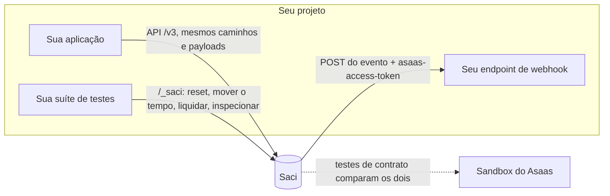

<div align="center">


# Saci

**O Asaas de mentira pros seus testes.**<br>
Pix, boleto, saldo, repasses e webhooks de verdade, num servidor local que se comporta como a API real.

[](https://github.com/SpackiGabriel/saci/actions/workflows/ci.yml)
[](https://github.com/SpackiGabriel/saci/pkgs/container/saci)
[](pyproject.toml)
[](LICENSE)

**Português** · [English](README.en.md)

</div>

> No folclore, o Saci é o moleque que faz você jurar que viu uma coisa que não aconteceu. Este aqui faz o mesmo com o seu código: o Pix caiu, o boleto venceu, o repasse saiu e o webhook chegou, tudo sem sair da sua máquina.

```bash
docker run --rm -p 8000:8000 ghcr.io/spackigabriel/saci
```

Aponte sua integração para `http://localhost:8000` em vez de `https://api-sandbox.asaas.com` e mande qualquer chave no header `access_token`. Não precisa de conta nem de internet, e funciona com qualquer linguagem.

Sem Docker, instale direto do GitHub (Python 3.11+):

```bash
pip install git+https://github.com/SpackiGabriel/saci
saci --port 8000
```

Com o servidor no ar, `http://localhost:8000/docs` mostra todos os endpoints numa página interativa.

---

## O problema

Os bugs que doem numa integração de pagamentos em produção raramente estão no caminho feliz. Estão no webhook que chega duas vezes, no endpoint que ficou fora do ar por uma hora enquanto os eventos se acumulavam, na cobrança que venceu no fim de semana e nos dois repasses que disputaram o mesmo saldo.

São justamente os casos que hoje **não dá** para testar direito:

|  | Sandbox real | Mock feito à mão | **Saci** |
| --- | :---: | :---: | :---: |
| Funciona offline, sem conta | ✗ | ✓ | ✓ |
| Estado limpo a cada teste | ✗ (compartilhado, nunca reseta) | ✓ | ✓ |
| "Agora são três dias depois" | ✗ | depende | ✓ |
| Seu endpoint de webhook caiu: retentativas, ordem, fila interrompida | ✗ | raramente | ✓ |
| Saldo de verdade: entrada, tarifa, saída, saldo insuficiente | ✓ | raramente | ✓ |
| Ids e respostas determinísticos | ✗ | ✓ | ✓ |
| Dá para conferir se continua igual à API real | ✓ | ✗ (diverge em silêncio) | ✓ (testes de contrato) |
| Rápido o bastante para todo teste | ✗ | ✓ | ✓ |

Um mock devolve o que o autor lembrou. O Saci guarda estado, movimenta dinheiro (fictício), entrega webhooks por HTTP e tem uma suíte de testes de contrato que roda tanto contra ele quanto contra o sandbox do Asaas. **Um fake que mente é pior que nenhum.**



## Um tour de 30 segundos

```bash
H='access_token: $aact_local'; API=http://localhost:8000

# Um cliente e uma cobrança Pix
curl -s -X POST $API/v3/customers -H "$H" -d '{"name": "Maria Souza", "cpfCnpj": "52998224725"}'
curl -s -X POST $API/v3/payments  -H "$H" \
  -d '{"customer": "cus_000000000001", "billingType": "PIX", "value": 101.99, "dueDate": "2030-01-10"}'

# O cliente paga: a mesma ação de sandbox que o Asaas oferece
curl -s -X POST $API/v3/sandbox/payment/pay_000000000001/confirm -H "$H"
curl -s $API/v3/finance/balance -H "$H"     # {"balance":100.0}   (tarifa de 1,99 descontada)

# Repasse via Pix
curl -s -X POST $API/v3/transfers -H "$H" \
  -d '{"value": 60, "pixAddressKey": "owner@example.com", "pixAddressKeyType": "EMAIL"}'
curl -s $API/v3/finance/balance -H "$H"     # {"balance":40.0}

# Tudo o que aconteceu, na ordem
curl -s $API/_saci/events -H "$H"           # PAYMENT_CREATED, PAYMENT_RECEIVED, TRANSFER_CREATED, TRANSFER_DONE
```

Os ids são sequenciais (`cus_000000000001`, `pay_000000000001`, ...). Com o relógio congelado, o mesmo teste contra um Saci recém-iniciado produz exatamente as mesmas respostas.

## Recebendo webhooks

Cadastre o endpoint como faria no Asaas. `name`, `url`, `email` e `events` são obrigatórios:

```bash
curl -s -X POST $API/v3/webhooks -H "$H" -d '{
  "name": "minha-app",
  "url": "http://host.docker.internal:3000/webhooks/asaas",
  "email": "dev@example.com",
  "authToken": "segredo-local-123",
  "events": ["PAYMENT_RECEIVED", "PAYMENT_OVERDUE", "TRANSFER_DONE", "TRANSFER_FAILED"]
}'
```

A partir daí, cada evento assinado chega como um `POST` no formato documentado, com o `authToken` no header `asaas-access-token`:

```json
{
  "id": "evt_00000000000000000000000000000002&2",
  "event": "PAYMENT_RECEIVED",
  "dateCreated": "2026-03-02 09:00:00",
  "payment": { "object": "payment", "id": "pay_000000000001", "status": "RECEIVED", "...": "..." }
}
```

Eventos de transferência trazem `transfer` no lugar de `payment`. O webhook só recebe eventos gerados depois do cadastro. As respostas nunca devolvem o `authToken`; elas mostram `hasAuthToken: true`.

Se o Saci roda em Docker e sua aplicação roda na máquina, use `host.docker.internal` na URL. No Linux isso exige `--add-host=host.docker.internal:host-gateway` no `docker run`. Num `docker compose`, use o nome do serviço (por exemplo `http://app:3000/...`).

Não precisa de receptor para testar: `GET /_saci/events` lista todos os eventos da conta e `GET /_saci/deliveries` mostra cada tentativa de entrega, com status HTTP e último erro.

## Nos seus testes

O Saci é só um servidor HTTP, então os testes conversam com ele pela rede. O padrão que funciona bem: antes de cada teste, apague o estado e congele o relógio.

```python
@pytest.fixture
def asaas():
    with httpx.Client(base_url="http://localhost:8000", headers={"access_token": "$aact_test"}) as client:
        client.post("/_saci/reset")
        client.post("/_saci/clock", json={"now": "2026-03-02T09:00:00"})
        yield client
```

Exemplos completos:

- **Python / pytest**: [`examples/python-pytest`](examples/python-pytest/test_billing_flow.py)
- **Node.js**: [`examples/node/payout.mjs`](examples/node/payout.mjs), só com o `fetch` nativo
- **Docker Compose**: [`examples/docker-compose.yml`](examples/docker-compose.yml), com sua aplicação ao lado do Saci

Os de Python e Node rodam no CI a cada pull request, contra um servidor de verdade.

No GitHub Actions, rode como service container:

```yaml
jobs:
  test:
    runs-on: ubuntu-latest
    services:
      asaas:
        image: ghcr.io/spackigabriel/saci
        ports: ["8000:8000"]
    steps:
      - uses: actions/checkout@v5
      - run: pytest
        env:
          ASAAS_BASE_URL: http://localhost:8000
```

Para manter o estado entre reinícios, monte um volume e aponte o banco para ele:

```bash
docker run --rm -p 8000:8000 -v saci-data:/data \
  -e SACI_DATABASE=/data/saci.db ghcr.io/spackigabriel/saci
```

As imagens saem para `linux/amd64` e `linux/arm64`. Tags: `latest`, `X.Y.Z` e `X.Y` a cada release, `edge` para a `main` atual e `sha-<commit>` para cada build.

## Receitas para os bugs que importam

**Seu receptor precisa aguentar entregas duplicadas.** A entrega é "pelo menos uma vez", e um evento reenviado mantém o mesmo `id`. Para controlar cada tentativa, suba o Saci com `SACI_DELIVERY_MODE=manual`: nada é entregue até você chamar `/_saci/webhooks/deliver`.

```python
# seu endpoint responde 500 na primeira chamada e 200 depois
asaas.post("/_saci/webhooks/deliver")   # tentativa 1 falha
asaas.post("/_saci/webhooks/deliver")   # tentativa 2, mesmo id de evento
assert pagamentos_processados == 1
```

**Seu endpoint ficou fora do ar.** Depois de 15 falhas seguidas o webhook fica `interrupted` e a fila para, como diz a documentação do Asaas. Os eventos novos continuam entrando na fila. Volte `interrupted` para `false` e eles chegam em ordem:

```bash
curl -X PUT $API/v3/webhooks/$WEBHOOK_ID -H "$H" -d '{"interrupted": false}'
```

Com `sendType: "SEQUENTIALLY"` (o padrão), um evento nunca passa na frente de outro mais antigo que ainda está falhando. `NON_SEQUENTIALLY` entrega cada um por conta própria.

**Cobranças vencem quando ninguém está olhando.**

```bash
curl -X POST $API/_saci/clock -d '{"advanceDays": 3}'
# cobranças pendentes com vencimento passado agora estão OVERDUE, e PAYMENT_OVERDUE foi emitido
```

**Repasses sem saldo, ou disputando saldo.** O saldo começa em zero e o débito é atômico. Oito transferências simultâneas contra um saldo que cobre três: passam exatamente três. Tem [um teste](tests/test_transfers.py) para isso.

**Um repasse agendado.** Com `scheduleDate` no futuro, o valor sai do saldo na hora e a transferência fica `PENDING`. Ela vira `DONE` quando o relógio chega na data:

```bash
curl -s -X POST $API/_saci/clock -d '{"now": "2026-03-02T09:00:00"}'
curl -s -X PUT $API/_saci/balance -H "$H" -d '{"balance": 500}'
curl -s -X POST $API/v3/transfers -H "$H" \
  -d '{"value": 100, "pixAddressKey": "owner@example.com", "pixAddressKeyType": "EMAIL", "scheduleDate": "2026-03-05"}'
# PENDING, saldo 400
curl -s -X POST $API/_saci/clock -d '{"advanceDays": 3}'
# DONE, TRANSFER_DONE emitido
```

**Um repasse falha depois de aceito.** Suba com `SACI_TRANSFER_MODE=manual` para as transferências ficarem `PENDING` e decida o desfecho:

```bash
curl -X POST $API/_saci/transfers/$TRANSFER_ID/fail -H "$H" -d '{"failReason": "Chave Pix inexistente"}'
# status FAILED, dinheiro devolvido ao saldo, TRANSFER_FAILED emitido
```

## Referência

### Endpoints do Asaas

| Área | Endpoints |
| --- | --- |
| Clientes | `POST/GET /v3/customers`, `GET/PUT/DELETE /v3/customers/{id}`, `POST .../restore` |
| Cobranças | `POST/GET /v3/payments`, `GET/PUT/DELETE /v3/payments/{id}`, `POST .../restore`, `GET .../status` |
| Pix e boleto | `GET .../pixQrCode`, `GET .../identificationField` |
| Dinheiro | `POST .../receiveInCash`, `POST .../undoReceivedInCash` |
| Ações de sandbox | `POST /v3/sandbox/payment/{id}/confirm`, `POST /v3/sandbox/payment/{id}/overdue` |
| Saldo | `GET /v3/finance/balance` |
| Transferências | `POST/GET /v3/transfers`, `GET /v3/transfers/{id}`, `DELETE /v3/transfers/{id}/cancel` |
| Webhooks | `POST/GET /v3/webhooks`, `GET/PUT/DELETE /v3/webhooks/{id}`, e a entrega de fato |

As respostas seguem a referência OpenAPI oficial: erro em `{"errors": [{"code", "description"}]}`, listas em `{"object": "list", "hasMore", "totalCount", "limit", "offset", "data"}`, `404` sem corpo para id desconhecido e `401` sem a chave.

O que o seu código interpreta tem formato de verdade:

- **Payload Pix**: um BR Code (EMV) válido, com CRC16 correto. O `encodedImage` é um QR code que dá para escanear.
- **Linha digitável e código de barras**: layout FEBRABAN (47 e 44 dígitos), com dígitos verificadores válidos e o fator de vencimento atual.
- **CPF e CNPJ**: validados pelo dígito verificador, como o sandbox faz.

**Regras que valem a pena saber:**

- Cobranças aceitam `PIX`, `BOLETO` e `UNDEFINED`. `CREDIT_CARD` retorna `unsupported_billingType` em vez de fingir que funciona.
- Só cobranças `PENDING` ou `OVERDUE` podem ser alteradas ou removidas. Mudar o `dueDate` volta a cobrança para `PENDING`.
- Recebimento em dinheiro (`receiveInCash`) não mexe no saldo, como no Asaas.
- Transferência Pix exige `pixAddressKey` e `pixAddressKeyType` (`CPF`, `CNPJ`, `EMAIL`, `PHONE` ou `EVP`); TED exige um objeto `bankAccount`. Só transferências `PENDING` podem ser canceladas, e o cancelamento devolve o valor ao saldo.
- `invoiceUrl` e `bankSlipUrl` apontam para uma página HTML simples do próprio Saci.

### Paginação e filtros

Listas vêm da mais nova para a mais antiga, com `offset` (padrão 0) e `limit` (padrão 10, máximo 100). Filtros que o Saci entende; qualquer outro parâmetro é ignorado:

| Lista | Filtros |
| --- | --- |
| `/v3/customers` | `name` (trecho do nome, sem diferenciar maiúsculas), `email`, `cpfCnpj`, `groupName`, `externalReference` |
| `/v3/payments` | `customer`, `billingType`, `status`, `externalReference`, `paymentDate`, e `[ge]`/`[le]` em `dueDate`, `paymentDate` e `dateCreated` |
| `/v3/transfers` | `type`, `dateCreated[ge]`, `dateCreated[le]` |

### Eventos de webhook

| Evento | Quando |
| --- | --- |
| `PAYMENT_CREATED` | cobrança criada |
| `PAYMENT_UPDATED` | cobrança alterada |
| `PAYMENT_DELETED` / `PAYMENT_RESTORED` | cobrança removida ou restaurada |
| `PAYMENT_RECEIVED` | confirmação de sandbox ou recebimento em dinheiro |
| `PAYMENT_RECEIVED_IN_CASH_UNDONE` | recebimento em dinheiro desfeito |
| `PAYMENT_OVERDUE` | vencimento forçado ou relógio passou do vencimento |
| `TRANSFER_CREATED` / `TRANSFER_DONE` | transferência criada ou liquidada |
| `TRANSFER_FAILED` / `TRANSFER_CANCELLED` | transferência falhou ou foi cancelada |

Clientes não geram eventos.

### API de controle

Estes endpoints não existem no Asaas. É por eles que os testes comandam o Saci. Os marcados com "conta" exigem `access_token` e agem só na conta daquela chave; os outros valem para o servidor inteiro.

| Endpoint | Escopo | O que faz |
| --- | --- | --- |
| `GET /_saci/health` | servidor | Disponibilidade, versão e horário emulado |
| `POST /_saci/reset` | servidor | Apaga todas as contas, zera os contadores de id e volta o relógio ao normal |
| `GET /_saci/clock` | servidor | Horário emulado e se está congelado |
| `POST /_saci/clock` | servidor | `{"now": "2026-01-31T09:00:00"}` congela o tempo; `{"advanceDays": 3}` avança. Depois aplica vencimentos e transferências agendadas |
| `PUT /_saci/balance` | conta | `{"balance": 500}` define o saldo |
| `GET /_saci/events` | conta | Todos os eventos gerados, em ordem |
| `GET /_saci/deliveries` | conta | Todas as tentativas de entrega de webhook, com status e último erro |
| `POST /_saci/webhooks/deliver` | servidor | Tenta agora todas as entregas pendentes, sem esperar o intervalo de retentativa |
| `POST /_saci/transfers/{id}/done` | conta | Liquida uma transferência pendente |
| `POST /_saci/transfers/{id}/fail` | conta | Faz uma transferência pendente falhar e devolve o dinheiro |

Sem congelar, o relógio acompanha o horário da máquina. Vencimentos e transferências agendadas só são aplicados quando você chama `POST /_saci/clock`.

### Configuração

| Variável | Padrão | Significado |
| --- | --- | --- |
| `SACI_DATABASE` | `:memory:` | Caminho do SQLite; use um arquivo para manter o estado entre reinícios |
| `SACI_API_KEYS` | (vazio) | Chaves aceitas, separadas por vírgula; vazio aceita qualquer chave não vazia |
| `SACI_FEE_PIX_PAYMENT` | `1.99` | Tarifa fixa de cobranças Pix |
| `SACI_FEE_BOLETO_PAYMENT` | `1.99` | Tarifa fixa de cobranças por boleto (e `UNDEFINED`) |
| `SACI_FEE_PIX_TRANSFER` | `0.00` | Tarifa de transferências Pix |
| `SACI_FEE_TED_TRANSFER` | `0.00` | Tarifa de transferências TED |
| `SACI_TRANSFER_MODE` | `auto` | `auto` liquida transferências na hora; `manual` espera a API de controle |
| `SACI_DELIVERY_MODE` | `background` | `background` entrega webhooks continuamente; `manual` só quando pedido |
| `SACI_WEBHOOK_MAX_FAILURES` | `15` | Falhas seguidas antes de o webhook ser interrompido |
| `SACI_WEBHOOK_RETRY_SECONDS` | `1.0` | Espera antes de tentar de novo uma entrega que falhou |
| `SACI_WEBHOOK_TIMEOUT_SECONDS` | `5.0` | Tempo máximo de espera pela resposta do seu endpoint |

O comando `saci` aceita `--host` e `--port` (ou as variáveis `HOST` e `PORT`); o padrão é `0.0.0.0:8000`. Um valor inválido em `SACI_TRANSFER_MODE` ou `SACI_DELIVERY_MODE` impede o servidor de subir.

## Fidelidade

Todo comportamento está num de dois grupos, e este README diz qual.

**Tirado da documentação oficial:** caminhos, campos de requisição e resposta, enums de status e eventos, envelopes de erro e lista, os headers `access_token` e `asaas-access-token`, o payload do webhook e o formato do id de evento, entrega "pelo menos uma vez", interrupção após 15 falhas seguidas e as ações de sandbox de confirmar e vencer.

**Suposto, até a suíte de contrato confirmar contra o sandbox:**

- quais eventos a confirmação de sandbox emite (o Saci emite só `PAYMENT_RECEIVED`);
- os códigos exatos de erro de validação e de saldo insuficiente;
- as tarifas padrão e o formato do id de transferência;
- se forçar o vencimento altera o `dueDate` (o Saci mantém).

**Diferente de propósito:** a retentativa de webhook espera um intervalo fixo e curto (1 segundo por padrão), bem menor que o do Asaas, para a sua suíte não travar. Os links de comprovante (`transactionReceiptUrl`) não abrem nada.

A suíte de contrato em [`tests/conformance`](tests/conformance/test_contract.py) roda contra o Saci por padrão e contra o sandbox real com uma chave:

```bash
ASAAS_CONFORMANCE_BASE_URL=https://api-sandbox.asaas.com \
ASAAS_CONFORMANCE_API_KEY='$aact_...' \
pytest -m conformance -v
```

Quando os dois discordam, quem muda é o Saci. Achou uma diferença? [Abra um relato de fidelidade](https://github.com/SpackiGabriel/saci/issues/new?template=fidelity.yml).

## Por que ele é assim

O Saci nasceu do [Soleira](https://soleira.app), um SaaS que construí para automatizar o fechamento financeiro mensal de imobiliárias em cima do Asaas: cobrar inquilinos, conciliar pagamentos e repassar aos proprietários via Pix. Testar esse fluxo contra o sandbox o dia inteiro era lento e instável, então o Soleira tinha o próprio fake do Asaas. A primeira versão era um mock simples, e ele escondia bugs reais. Cada decisão abaixo corrige um deles:

- **O saldo começa em zero.** O mock antigo dava a toda conta um saldo generoso, enquanto uma conta nova do sandbox responde `{"balance": 0}`, justamente o caso que quebra primeiro em produção. Abasteça a conta como no sandbox, confirmando uma cobrança, ou com `PUT /_saci/balance`.
- **O débito é um único `UPDATE` condicional.** O mock lia o saldo e depois escrevia, uma condição de corrida esperando acontecer. `UPDATE ... WHERE balance >= valor` não gasta o mesmo dinheiro duas vezes, nem com requisições simultâneas.
- **O estado vive no SQLite.** O mock guardava tudo em memória e, ao reiniciar, reemitia ids que já existiam no banco do Soleira. Com `SACI_DATABASE` apontando para um arquivo, nada se perde nem se repete.
- **Mudança de estado e evento entram juntos.** Uma cobrança nunca muda de status sem o evento entrar na fila na mesma transação (um outbox transacional).
- **O tempo é uma entrada.** Um relógio controlável transforma o que depende de data em algo testável e repetível.
- **Cada chave de API é uma conta.** Clientes, cobranças, saldo, webhooks e eventos nunca se misturam entre chaves, então vários tenants de um produto multi-tenant podem dividir um Saci. O relógio, o `reset` e os contadores de id são do servidor inteiro: testes em paralelo que mexem no tempo ou resetam o estado precisam de um Saci cada.

O Saci reescreve essas ideias do zero como ferramenta independente, para que qualquer time que integra com o Asaas, em qualquer linguagem, teste os casos difíceis sem construir o próprio fake.

## Roadmap

- [x] Clientes, cobranças Pix e boleto, ações de sandbox, saldo, transferências, webhooks
- [x] Suíte de testes de contrato contra o sandbox real
- [x] Imagem no GitHub Container Registry (amd64 e arm64)
- [ ] Pacote no PyPI
- [ ] Estornos totais e parciais
- [ ] Assinaturas e parcelamentos
- [ ] Split de pagamentos
- [ ] Cartão (tokenização, autorização e captura)
- [ ] Gravar tráfego real do sandbox e reproduzir como fixture

## Contribuindo

A contribuição mais valiosa é um relato de diferença entre o Saci e a API real, de preferência com um teste de contrato que falha. Itens do roadmap também são bem-vindos. O [CONTRIBUTING.md](CONTRIBUTING.md) explica onde fica cada coisa e como rodar tudo:

```bash
pip install -e ".[dev]"
pytest --cov
```

## Licença

[MIT](LICENSE). Sem vínculo com o Asaas nem endosso dele; "Asaas" é marca do seu titular. O Saci nunca fala com a API real, exceto nos testes de contrato opcionais.
