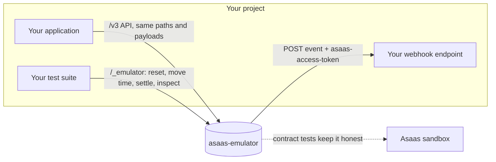

<div align="center">

# asaas-emulator

**Test your Asaas integration offline.**<br>
Pix, boleto, balances, payouts and real webhook deliveries, in a local server that behaves like the real API.

[](https://github.com/SpackiGabriel/asaas-emulator/actions/workflows/ci.yml)
[](https://github.com/SpackiGabriel/asaas-emulator/pkgs/container/asaas-emulator)
[](pyproject.toml)
[](LICENSE)

**English** · [Português](README.pt-BR.md)

</div>

```bash
docker run --rm -p 8000:8000 ghcr.io/spackigabriel/asaas-emulator
```

Point your integration at `http://localhost:8000` instead of `https://api-sandbox.asaas.com`. That is the whole setup: no account, no network, any language.

---

## The problem

The bugs that hurt a payment integration in production are rarely the happy path. They are the webhook that arrives twice, the endpoint that was down for an hour while events piled up, the charge that went overdue over the weekend, and the two payouts that raced for the same balance.

Those are exactly the cases you **cannot** test well today:

|  | Real sandbox | Hand-written mock | **asaas-emulator** |
| --- | :---: | :---: | :---: |
| Works offline, without an account | ✗ | ✓ | ✓ |
| Clean state for every test | ✗ (shared, never reset) | ✓ | ✓ |
| "It is now three days later" | ✗ | depends | ✓ |
| Your webhook endpoint is down: retries, ordering, queue interruption | ✗ | rarely | ✓ |
| Real balances: money in, fees, money out, overdraft refused | ✓ | rarely | ✓ |
| Deterministic ids and responses | ✗ | ✓ | ✓ |
| Stays faithful to the real API over time | ✓ | ✗ (drifts silently) | ✓ (contract test suite) |
| Fast enough for every test run | ✗ | ✓ | ✓ |

A mock returns whatever its author remembered. This emulator keeps real state, moves real (fake) money, delivers real HTTP webhooks, and is checked against the actual sandbox by a contract test suite. **A fake that lies is worse than no fake.**

## How it fits



## A 30-second tour

```bash
H='access_token: $aact_local'; API=http://localhost:8000

# A customer and a Pix charge
curl -s -X POST $API/v3/customers -H "$H" -d '{"name": "Maria Souza", "cpfCnpj": "52998224725"}'
curl -s -X POST $API/v3/payments  -H "$H" \
  -d '{"customer": "cus_000000000001", "billingType": "PIX", "value": 101.99, "dueDate": "2030-01-10"}'

# The customer pays: same sandbox action Asaas offers
curl -s -X POST $API/v3/sandbox/payment/pay_000000000001/confirm -H "$H"
curl -s $API/v3/finance/balance -H "$H"     # {"balance": 100.0}   (1.99 fee deducted)

# Pay someone out over Pix
curl -s -X POST $API/v3/transfers -H "$H" \
  -d '{"value": 60, "pixAddressKey": "owner@example.com", "pixAddressKeyType": "EMAIL"}'
curl -s $API/v3/finance/balance -H "$H"     # {"balance": 40.0}
```

Ids are sequential (`cus_000000000001`, `pay_000000000001`, ...), so the same test against a fresh emulator always produces the same traffic.

## Recipes for the bugs that matter

**Your receiver must survive duplicate deliveries.** Delivery is at-least-once, so a retried event keeps its `id`. Make your endpoint fail once and assert you processed the payment only once:

```python
# your endpoint answers 500 on the first call, 200 afterwards
asaas.post("/_emulator/webhooks/deliver")   # attempt 1 fails
asaas.post("/_emulator/webhooks/deliver")   # attempt 2, same event id
assert payments_processed == 1
```

**Your endpoint was down.** After 15 consecutive failures the webhook is marked `interrupted` and the queue stops, as documented. Events keep piling up. Set `interrupted` back to `false` and they arrive in order:

```bash
curl -X PUT $API/v3/webhooks/$WEBHOOK_ID -H "$H" -d '{"interrupted": false}'
```

**Charges go overdue while nobody is looking.**

```bash
curl -X POST $API/_emulator/clock -d '{"advanceDays": 3}'
# pending charges past their due date are now OVERDUE, and PAYMENT_OVERDUE was emitted
```

**Payouts without funds, or racing each other.** Balances start at zero and debits are atomic. Eight concurrent transfers against a balance that covers three: exactly three succeed. There is a test for that.

**A payout fails after it was accepted.** Run with `ASAAS_EMULATOR_TRANSFER_MODE=manual`, then decide the outcome:

```bash
curl -X POST $API/_emulator/transfers/$TRANSFER_ID/fail -H "$H" -d '{"failReason": "Chave Pix inexistente"}'
# status FAILED, money returned to the balance, TRANSFER_FAILED emitted
```

## Use it from any language

It is an HTTP server, so anything that can call the real API can call the emulator. Runnable examples:

- **Python / pytest**: [`examples/python-pytest`](examples/python-pytest/test_billing_flow.py), with a fixture that resets and freezes the emulator before each test.
- **Node.js**: [`examples/node/payout.mjs`](examples/node/payout.mjs), using only the built-in `fetch`.
- **Docker Compose**: [`examples/docker-compose.yml`](examples/docker-compose.yml), to run your app next to it.

In GitHub Actions, run it as a service container next to your tests:

```yaml
services:
  asaas:
    image: ghcr.io/spackigabriel/asaas-emulator
    ports: ["8000:8000"]
steps:
  - run: pytest
    env:
      ASAAS_BASE_URL: http://localhost:8000
```

To keep state across restarts, mount a volume and point the database at it:

```bash
docker run --rm -p 8000:8000 -v asaas-data:/data \
  -e ASAAS_EMULATOR_DATABASE=/data/asaas.db ghcr.io/spackigabriel/asaas-emulator
```

Tags: `latest` and `X.Y.Z` for releases, `edge` for the current `main`. Images are built for `linux/amd64` and `linux/arm64`.

## What it emulates

| Area | Endpoints |
| --- | --- |
| Customers | `POST/GET /v3/customers`, `GET/PUT/DELETE /v3/customers/{id}`, `POST .../restore` |
| Payments | `POST/GET /v3/payments`, `GET/PUT/DELETE /v3/payments/{id}`, `POST .../restore`, `GET .../status` |
| Pix and boleto | `GET .../pixQrCode`, `GET .../identificationField` |
| Cash | `POST .../receiveInCash`, `POST .../undoReceivedInCash` |
| Sandbox actions | `POST /v3/sandbox/payment/{id}/confirm`, `POST /v3/sandbox/payment/{id}/overdue` |
| Balance | `GET /v3/finance/balance` |
| Transfers | `POST/GET /v3/transfers`, `GET /v3/transfers/{id}`, `DELETE /v3/transfers/{id}/cancel` |
| Webhooks | `POST/GET /v3/webhooks`, `GET/PUT/DELETE /v3/webhooks/{id}`, and actual delivery |

Responses follow the official OpenAPI reference: the `{"errors": [{"code", "description"}]}` envelope, the `{"object": "list", "hasMore", "totalCount", ...}` list envelope, a bare `404` for unknown ids, and authentication through the `access_token` header.

The artefacts your code parses have real structure, not placeholders:

- **Pix payloads** are valid BR Codes (EMV) with a correct CRC16, and `encodedImage` is a scannable QR code.
- **Boleto lines and barcodes** follow the FEBRABAN layout (47 and 44 digits) with valid check digits and the current due-date factor.
- **CPF and CNPJ** are validated by check digit, as the sandbox does.

## How it stays honest

Every behaviour is in one of two groups, and the README says which.

**From the official documentation:** paths, request and response fields, status and event enums, error and list envelopes, the `access_token` and `asaas-access-token` headers, the webhook payload and event id format, at-least-once delivery, interruption after 15 consecutive failures, and the sandbox confirm and overdue actions.

**Assumed until the contract suite confirms them against the sandbox:**

- which events a sandbox confirmation emits (the emulator emits `PAYMENT_RECEIVED` only);
- the exact error `code` strings for validation failures and insufficient balance;
- the default fee amounts and the transfer id format;
- whether forcing overdue changes `dueDate` (the emulator keeps it).

The contract suite in [`tests/conformance`](tests/conformance/test_contract.py) runs against the emulator by default and against the real sandbox with a key:

```bash
ASAAS_CONFORMANCE_BASE_URL=https://api-sandbox.asaas.com \
ASAAS_CONFORMANCE_API_KEY='$aact_...' \
pytest -m conformance -v
```

When the two disagree, the emulator is the side that changes. Found a difference? [Open a fidelity report](https://github.com/SpackiGabriel/asaas-emulator/issues/new?template=fidelity.yml).

## Design decisions

- **Every API key is its own account.** Customers, payments, balances and webhooks never cross between keys, so parallel tests, or every tenant of a multi-tenant product, can share one emulator.
- **Balances start at zero.** A generous default balance hides the most common real failure. Fund an account the way you would in the sandbox, by confirming a charge, or set it with `PUT /_emulator/balance`.
- **Debits are one conditional `UPDATE`.** "Read the balance, compare, write" is a race; `UPDATE ... WHERE balance >= amount` is not. Money cannot be double-spent, even under concurrent requests.
- **State changes and their events commit together.** A payment never changes status without its webhook event being queued in the same transaction (a transactional outbox).
- **State lives in SQLite, not in dictionaries.** Request handlers and the webhook worker share it safely, and pointing `ASAAS_EMULATOR_DATABASE` at a file keeps it across restarts without reissuing ids that already exist.
- **Time is an input.** A controllable clock makes date-dependent behaviour testable instead of flaky.

## Why this exists

This project grew out of [Soleira](https://soleira.app), a SaaS I built that automates the monthly financial close of property-management companies on top of Asaas: billing tenants, reconciling payments and paying property owners over Pix.

Testing that kind of money flow against the sandbox all day was slow and unreliable, so Soleira had its own in-process Asaas fake. Its first version was a simple mock, and that mock hid real bugs:

- it handed every account a generous starting balance, while a fresh sandbox account answers `{"balance": 0}`, the case that breaks first in production;
- it debited balances with a read followed by a write, a race waiting to happen;
- it kept state in memory, so a restart reissued ids that already existed in the database.

Fixing those taught the principles above. `asaas-emulator` is a clean-room, standalone rewrite of those ideas, so that any team integrating with Asaas, in any language, can test the hard cases without building their own fake.

## Configuration

| Variable | Default | Meaning |
| --- | --- | --- |
| `ASAAS_EMULATOR_DATABASE` | `:memory:` | SQLite path; use a file to keep state across restarts |
| `ASAAS_EMULATOR_API_KEYS` | (empty) | Comma-separated accepted keys; empty accepts any non-empty key |
| `ASAAS_EMULATOR_FEE_PIX_PAYMENT` | `1.99` | Flat fee on Pix charges |
| `ASAAS_EMULATOR_FEE_BOLETO_PAYMENT` | `1.99` | Flat fee on boleto charges |
| `ASAAS_EMULATOR_FEE_PIX_TRANSFER` | `0.00` | Fee on outgoing Pix transfers |
| `ASAAS_EMULATOR_FEE_TED_TRANSFER` | `0.00` | Fee on outgoing TED transfers |
| `ASAAS_EMULATOR_TRANSFER_MODE` | `auto` | `auto` settles transfers immediately; `manual` waits for the control API |
| `ASAAS_EMULATOR_DELIVERY_MODE` | `background` | `background` delivers webhooks continuously; `manual` only on request |
| `ASAAS_EMULATOR_WEBHOOK_MAX_FAILURES` | `15` | Consecutive failures before a webhook is interrupted |
| `ASAAS_EMULATOR_WEBHOOK_RETRY_SECONDS` | `1.0` | Delay before retrying a failed delivery |

## Control API

These endpoints do not exist in Asaas. They are how tests drive the emulator.

| Endpoint | What it does |
| --- | --- |
| `GET /_emulator/health` | Liveness, version and current emulated time |
| `POST /_emulator/reset` | Wipes all accounts and resets the clock |
| `GET /_emulator/clock` | Current emulated time |
| `POST /_emulator/clock` | `{"now": "2026-01-31T09:00:00"}` freezes time; `{"advanceDays": 3}` moves it |
| `PUT /_emulator/balance` | `{"balance": 500}` sets the balance of the calling account |
| `GET /_emulator/events` | Every event produced for the calling account, in order |
| `GET /_emulator/deliveries` | Every webhook delivery attempt, with status and last error |
| `POST /_emulator/webhooks/deliver` | Attempts all pending deliveries now, ignoring backoff |
| `POST /_emulator/transfers/{id}/done` | Settles a pending transfer |
| `POST /_emulator/transfers/{id}/fail` | Fails a pending transfer and returns the money |

## Roadmap

- [x] Customers, Pix and boleto charges, sandbox actions, balance, transfers, webhooks
- [x] Contract test suite against the real sandbox
- [x] Container image on GitHub Container Registry (amd64 and arm64)
- [ ] PyPI package
- [ ] Refunds and partial refunds
- [ ] Subscriptions and installments
- [ ] Split payments
- [ ] Card payments (tokenization, authorization and capture)
- [ ] Request recording to replay real sandbox traffic as fixtures

Card charges currently return a clear `unsupported_billingType` error instead of pretending.

## Contributing

Reports of the emulator disagreeing with the real API are the most valuable contribution. See [CONTRIBUTING.md](CONTRIBUTING.md).

```bash
pip install -e ".[dev]"
pytest --cov          # 80+ tests, coverage gate at 85%
ruff check src tests
mypy
```

Every pull request runs lint and type checks, the test suite on Python 3.11 to 3.13, the examples against a live server, a package build verified with `twine`, a Dockerfile lint, and a real image build that is started and smoke-tested before anything is published.

## License

[MIT](LICENSE). Not affiliated with or endorsed by Asaas; "Asaas" is a trademark of its owner. The emulator never talks to the real API, except in the opt-in contract tests.
